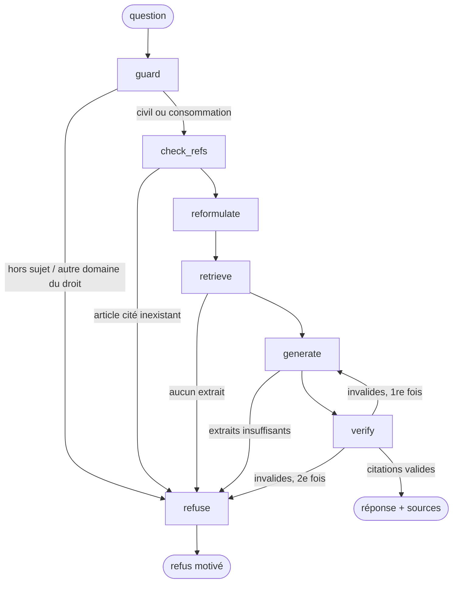

# legal-rag-agent

Assistant de questions-réponses sur le **Code civil** et le **Code de la consommation**, qui cite l'article exact de chaque affirmation, refuse quand l'information n'est pas dans ces deux codes, et dont la qualité est mesurée automatiquement à chaque changement de prompt ou de modèle.

> Information juridique générale, pas un conseil juridique. Le corpus est figé à avril 2025.

Exemple :

```
$ python graph.py "J'ai commandé une veste sur internet et elle ne me plaît pas. Combien de temps ai-je pour changer d'avis ?"
status : answered

Pour un contrat conclu à distance, vous disposez d'un délai de quatorze jours pour exercer votre droit
de rétractation, sans avoir à motiver votre décision [Code de la consommation, art. L221-18]. […]

Citations :
  - Code de la consommation, art. L221-18 : https://www.legifrance.gouv.fr/codes/article_lc/LEGIARTI000032226842
  - …
```

## Ce que le projet cherche à démontrer

L'agent est le sujet d'étude ; **le livrable principal est l'instrument de mesure** : un jeu de test étiqueté, des métriques déterministes qui ne dépendent pas d'un LLM, un juge LLM et RAGAS en complément, et une suite de non-régression qui échoue si l'on change un prompt sans rejouer l'évaluation.

## Architecture



| Nœud | Rôle | LLM ? |
|---|---|---|
| `guard` | Garde-fou hors-sujet : classe la question en `civil_conso`, `autre_droit` ou `hors_sujet`. La question est traitée comme une donnée (résiste aux « ignore tes instructions »). | oui |
| `check_refs` | Si la question cite un article (« art. 4521-99 ») qui n'existe pas, refus immédiat. | non |
| `reformulate` | Traduit la question en 2-3 requêtes en vocabulaire juridique (« changer d'avis » → « droit de rétractation »). | oui |
| `retrieve` | Recherche hybride : FAISS (dense) + BM25, fusion RRF, accès direct par numéro d'article, fusion des requêtes reformulées. 8 extraits. | non |
| `generate` | Réponse courte, chaque affirmation suivie de `[Code, art. N]`, uniquement à partir des extraits ; peut déclarer les extraits insuffisants. | oui |
| `verify` | Vérification déterministe : chaque article cité existe dans le catalogue **et** fait partie des extraits récupérés ; les références dans le texte correspondent aux citations. Une seule nouvelle tentative avec le motif du rejet, puis refus. | non |

Chaque refus a un statut distinct (`refused_off_topic`, `refused_out_of_scope`, `refused_unknown_article`, `refused_no_info`, `refused_unverified`) : l'évaluation s'appuie sur le statut, pas sur le texte.

Le graphe est volontairement à enchaînement fixe plutôt qu'un agent qui choisit ses outils : sur 2-3 jours, un flux borné est plus fiable, plus testable et plus facile à évaluer. Les sorties structurées passent par le tool calling (DeepSeek refuse le mode `json_schema`).

### Fichiers

| Fichier | Contenu |
|---|---|
| `ingest.py` | Chargement du dataset, nettoyage, dédoublonnage, découpage, index FAISS |
| `retriever.py` | Recherche hybride et détection des références d'articles |
| `llm.py` | Client DeepSeek et cache SQLite des appels |
| `reformulate.py` | Reformulation et recherche multi-requêtes |
| `graph.py` | Graphe LangGraph, garde-fous, vérification des citations |
| `eval/questions.jsonl` | Jeu de test (60 questions) |
| `eval/run_eval.py` | Évaluation : métriques déterministes, juge LLM, RAGAS |
| `eval/baseline.py` | Fige un run comme référence de non-régression |
| `tests/` | Tests unitaires hors-ligne et tests de non-régression |

## Données

Dataset : [`Tricoteuses/LEGI`](https://huggingface.co/datasets/Tricoteuses/LEGI) (articles en vigueur des codes français, source DILA, licence MIT), révision figée `48fe0f8`. Le dataset `Tricoteuses/codes_juridiques` mentionné dans le sujet n'est plus accessible publiquement ; `LEGI` en est l'équivalent.

Pourquoi ces deux codes : ce sont des codes que le grand public interroge (contrats, responsabilité, famille, achats, crédit), ils sont de taille raisonnable (≈ 5 100 articles), et leurs numéros ne se confondent pas (`1240` d'un côté, `L221-18` de l'autre), ce qui simplifie la vérification des citations. Le Code du travail (12 000 articles) a été écarté pour tenir le délai.

Constats sur les données, qui ont guidé l'ingestion :

- **Plusieurs versions d'un même article sont marquées « en vigueur »** (ex. Code civil art. 1842, versions de 1978 et de 2024). On garde la plus récente ; sans cela, l'index contient des textes contradictoires.
- Les renvois s'écrivent `L. 221-18` dans le texte mais `L221-18` dans les métadonnées : une seule fonction `normalize_num` sert à l'ingestion et à la vérification des citations.
- Un chunk = un article, préfixé par le code, le numéro et le chemin (Livre > Titre > Chapitre). Les rares articles de plus de 300 mots sont découpés par phrases et énumérations, sans couper les références.
- `quality_signals` est tronqué dans toutes les lignes et `date_fin` vaut toujours `2999-01-01` : colonnes ignorées.

## Installation

```bash
python3 -m venv .venv
.venv/bin/pip install torch --index-url https://download.pytorch.org/whl/cpu
.venv/bin/pip install -r requirements.txt
```

Créer un fichier `.env` à la racine (ignoré par git) :

```
DEEPSEEK_API_KEY=sk-...
RETRIEVER_DATA_DIR=data/e5-base
RETRIEVER_MODEL=intfloat/multilingual-e5-base
```

Construire l'index (≈ 15 min sur CPU pour e5-base) :

```bash
.venv/bin/python ingest.py --model intfloat/multilingual-e5-base --out data/e5-base
```

`ragas==0.4.3` exige `langchain-community==0.3.31` (il importe des modules retirés en 0.4) : les versions sont épinglées dans `requirements.txt`.

## Utilisation

```bash
python graph.py "Peut-on se marier à 16 ans ?"          # agent complet
python retriever.py "délai de rétractation" -k 5        # recherche seule
python reformulate.py "J'ai renvoyé un colis..."        # reformulation + recherche
python graph.py --mermaid                               # diagramme du graphe
```

## Évaluation

### Jeu de test

60 questions dans `eval/questions.jsonl`, rédigées en langage courant (« J'ai cassé la vitre de la voiture de mon voisin… ») et non en reprenant le vocabulaire des articles, pour ne pas rendre la recherche artificiellement facile :

| Catégorie | Nombre | Comportement attendu |
|---|---|---|
| `answerable` | 40 | Répondre en citant l'un des articles attendus (23 Code civil, 17 Code de la consommation, dont 3 qui citent un numéro) |
| `out_of_corpus` | 10 | Refuser : autre code (travail, pénal, route, urbanisme…) ou article inexistant (`4521-99`, `L999-1`) |
| `off_topic` | 10 | Refuser : hors sujet, dont une tentative d'injection de prompt |

Chaque question porte les articles attendus (vérité terrain, vérifiée contre le catalogue) et une réponse de référence.

### Métriques

**Déterministes, sans LLM** (elles servent de verrou de non-régression) :

| Métrique | Définition |
|---|---|
| `retrieval_hit_rate` | Part des questions `answerable` dont un article attendu figure dans les extraits récupérés |
| `answer_rate` / `false_refusal_rate` | Part des `answerable` auxquelles l'agent répond / qu'il refuse à tort |
| `citation_accuracy` | Parmi les réponses, part qui cite au moins un article attendu |
| `correct_refusal_rate` / `false_answer_rate` | Part des `out_of_corpus` + `off_topic` refusées / répondues à tort |
| `off_topic_detection` | Part des `off_topic` arrêtées par le garde-fou |

Le taux de refus n'est jamais lu seul : un agent qui refuse tout aurait un taux de refus parfait. On suit ensemble les refus à tort et les réponses à tort.

**LLM-as-a-judge** (`--judge`) : DeepSeek note chaque réponse de 0 à 2 sur l'exactitude (par rapport à la réponse de référence) et l'ancrage (chaque affirmation est-elle soutenue par le texte des articles cités ?).

**RAGAS** (`--ragas`) : `faithfulness`, `answer_relevancy`, `context_recall`.

Le juge et RAGAS utilisent le même LLM que l'agent : leurs scores sont indicatifs, pas une preuve indépendante. C'est pourquoi ils ne bloquent pas la non-régression.

```bash
python eval/run_eval.py --label mon-essai --judge --ragas
```

Chaque run est écrit dans `eval/runs/<date>_<label>/` : `results.jsonl`, `summary.json`, `config.json` (modèles, empreinte des prompts, commit git), `judge.jsonl`, `ragas.csv`.

### Résultats

DeepSeek `deepseek-chat`, multilingual-e5-base. Deux runs : la première version (`baseline-e5base`), puis la version actuelle (`guard-perquery`, référence de `eval/baseline.json`) avec deux changements mesurés séparément avant d'être combinés :

- **garde-fou** : le prompt énumère ce que couvrent les deux codes et, en cas de doute, laisse passer la question (la vérification aval refuse ce qui n'est pas trouvé) ;
- **fusion multi-requêtes** : le meilleur résultat de chaque reformulation est garanti parmi les 8 extraits (mesuré hors-ligne sur les reformulations du premier run : 32 → 35/40 ; les variantes plus complexes ne faisaient pas mieux).

| Métrique | baseline-e5base | guard-perquery |
|---|---|---|
| Recherche : article attendu parmi les extraits | 80 % (32/40) | **90 %** (36/40) |
| Taux de réponse (`answerable`) | 90 % (36/40) | **97,5 %** (39/40) |
| Précision des citations | 88,9 % (32/36) | **92,3 %** (36/39) |
| Refus corrects (hors corpus + hors sujet) | 100 % (20/20) | 100 % (20/20) |
| Réponses à tort | 0 % | 0 % |
| Détection du hors-sujet (dont injection) | 100 % | 100 % |
| Juge : exactitude / ancrage | 95,8 % / 100 % | 96,2 % / 98,7 % |
| RAGAS : faithfulness | 82,8 % | 78,3 % |
| RAGAS : answer relevancy | 86,3 % | 86,2 % |
| RAGAS : context recall | 83,3 % | 87,2 % |
| Latence p50 / p95 | 4,0 s / 4,9 s | 1,9 s / 2,7 s* |

\* Latence du second run réduite par le cache LLM : pas une amélioration réelle.

La baisse de faithfulness RAGAS accompagne la hausse du taux de réponse : l'agent répond désormais à des questions plus difficiles qu'il refusait, et RAGAS (même LLM que l'agent) note plus sévèrement ces réponses. La vérification déterministe des citations, elle, n'a laissé passer aucune citation hors des extraits.

Échecs restants (4) : âge du mariage (art. 144 jamais récupéré, refus prudent) ; abus de faiblesse (L121-8) et information précontractuelle (L111-1) non cités ; préjudice écologique, où l'agent cite les articles 1247 à 1252 (régime de réparation, juridiquement correct) alors que seul 1246 est attendu. Ce dernier cas n'a pas été corrigé dans le jeu de test, pour ne pas ajuster la mesure à l'agent à chaque run.

Lecture des 8 échecs du premier run :

- 3 refus prudents (âge du mariage, prescription, obligation alimentaire) : la reformulation est bonne mais l'article exact n'est pas récupéré ; l'agent refuse au lieu d'inventer.
- 1 refus du garde-fou à tort : le préjudice écologique (art. 1246 du Code civil) classé en droit de l'environnement.
- 2 vrais ratés : abus de faiblesse (L121-8) confondu avec le droit de rétractation ; obligation d'information précontractuelle sans L111-1.
- 2 réponses juridiquement défendables mais hors des articles attendus (1112-1 au lieu de 1104, 1242 au lieu de 1241) : limite du jeu de test plutôt que de l'agent. Ces deux articles ont été **ajoutés** aux articles attendus après ce run (champ `note` dans `questions.jsonl`), sans retirer les articles d'origine. Corriger la vérité terrain après avoir vu les résultats favorise l'agent : c'est signalé ici pour que les chiffres suivants soient lus en conséquence.

Le 100 % d'ancrage du juge est à prendre avec prudence : le même LLM génère et juge.

Recherche seule, sans reformulation (40 questions `answerable`) :

| Index | hit@1 | hit@5 | hit@20 |
|---|---|---|---|
| multilingual-e5-small | 7/40 | 15/40 | 20/40 |
| multilingual-e5-base | 8/40 | 18/40 | 26/40 |

L'écart entre le langage courant des questions et le vocabulaire juridique des articles est le principal problème de la recherche ; BM25 seul (7/40) n'aide pas, d'où le nœud de reformulation.

## Non-régression

```bash
pytest -m "not regression"         # tests unitaires, hors-ligne
python eval/run_eval.py --label X  # après un changement de prompt ou de modèle
pytest -m regression               # compare le run au baseline
python eval/baseline.py            # accepter le run courant comme nouvelle référence
```

Le test de régression calcule l'empreinte de la configuration courante (prompts, modèle LLM, modèle d'embedding) et cherche un run d'évaluation qui lui correspond. **Si un prompt ou un modèle a changé sans que l'évaluation ait été rejouée, la suite échoue.** `pytest --run-eval` rejoue l'évaluation automatiquement ; le cache SQLite des appels LLM (`.cache/llm.sqlite`) rend gratuit le rejeu des appels inchangés.

Assertions bloquantes : aucune erreur ; aucune métrique déterministe en baisse de plus de 5 points par rapport à `eval/baseline.json` ; au plus 2 questions qui passaient et ne passent plus ; détection du hors-sujet ≥ 90 % et réponses à tort ≤ 20 %. Le juge et RAGAS produisent des avertissements, pas des échecs.

## Limites

- **Le jeu de test a été rédigé avec l'aide d'un LLM** puis vérifié contre le catalogue ; les réponses de référence méritent une relecture par un juriste.
- 60 questions ne couvrent qu'une petite partie des deux codes ; un écart de 1 question = 2,5 points sur les métriques `answerable`.
- Les renvois entre articles ne sont pas suivis, et la jurisprudence (souvent décisive en responsabilité civile) est hors corpus.
- Corpus figé à avril 2025 ; pour un usage réel, il faudrait gérer le droit en vigueur à une date donnée.
- Un même LLM génère, reformule et juge : les scores du juge et de RAGAS sont à interpréter avec prudence.

## Pistes

- Publier le jeu de test sur Hugging Face Hub.
- Comparer plusieurs LLM avec la même suite d'évaluation (tableau qualité / coût / latence).
- Intégration continue : rejouer l'évaluation sur chaque PR qui touche un prompt.
- Démo interactive (Hugging Face Space) avec liens Légifrance cliquables.
